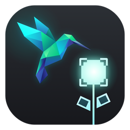
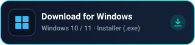
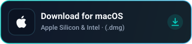

<p align="right">
  <a href="README.md">🇪🇸 Español</a> &nbsp;|&nbsp; <strong>🇺🇸 English</strong>
</p>

<div align="center">



# ZunzShot

**Instant, ultra-lightweight, and creative screenshot tool for macOS and Windows.**

[](#downloads-v108)
[](#downloads-v108)
[](README.md)

<br />

<a href="https://github.com/ExtremeRayoX/ZunzShot/releases/download/v1.0.8/ZunzShot_1.0.8_x64-setup.exe"></a>
&nbsp;&nbsp;
<a href="https://github.com/ExtremeRayoX/ZunzShot/releases/download/v1.0.8/ZunzShot_1.0.8_universal.dmg"></a>

</div>

---

## Downloads (`v1.0.8`)

Latest available version: **ZunzShot v1.0.8**. Click directly on your operating system button above or your installer below to start an **instant direct download** *(no intermediate pages)*:

| OS | Platform | Direct Download (`v1.0.8`) | Details |
| :---: | :--- | :--- | :--- |
|  | **Windows 10 / 11 (64-bit)** | [Download v1.0.8 (.exe)](https://github.com/ExtremeRayoX/ZunzShot/releases/download/v1.0.8/ZunzShot_1.0.8_x64-setup.exe) | Official compact installer with built-in language selector (**English / Español**) and automatic updates. |
|  | **macOS 12.3+ (Apple Silicon & Intel)** | [Download v1.0.8 for macOS (.dmg)](https://github.com/ExtremeRayoX/ZunzShot/releases/download/v1.0.8/ZunzShot_1.0.8_universal.dmg) | Drag **ZunzShot** to **Applications** and grant **Screen Recording** permission on first launch. |

> **macOS note:** If Gatekeeper shows an unverified developer prompt on first launch, **right-click → Open** on the app in Applications or run in Terminal:
> ```bash
> xattr -cr /Applications/ZunzShot.app
> ```

---

## Privacy & 100% Local Operation

ZunzShot is built with a **local-first** architecture to keep your screen and files private:

- **100% local processing:** All screenshots, annotations, stickers, text labels, and exports are processed and kept strictly on your machine (RAM, system clipboard, or your chosen save folder).
- **No cloud or third-party servers:** Your captures are never uploaded or shared externally unless you explicitly trigger **Share** or **Save**.
- **Zero telemetry or tracking:** No usage analytics, ads, background data collection, or accounts required.
- **Optional network check solely for updates:** The only optional outbound request is checking official GitHub Releases (`github.com/ExtremeRayoX/ZunzShot/releases`) when automatic updates or manual *Check for updates* are used in Settings (you can disable auto-checks at any time).

---

## Features & Icons

When triggering a capture, ZunzShot opens a floating overlay with **capture modes**, a **horizontal editing toolbar**, **creative stickers**, and a **vertical action bar**. Here is what each icon does inside the app:

### Capture Modes

| Icon | Mode | macOS Shortcut | Windows Shortcut | Description |
| :---: | :--- | :---: | :---: | :--- |
|  | **Quick Copy** | `⌘ + ⇧ + D` | `Ctrl + Shift + D` | Select any area and, on mouse release, immediately copy it to the clipboard, close the overlay, and show a non-intrusive toast without stealing focus. |
|  | **Free Region** | `⌘ + ⇧ + X` | `Ctrl + Shift + X` | Draw a movable, resizable rectangular selection with a pixel-precision loupe and full annotation toolbar. |
|  | **Circle Capture** | `⌘ + ⇧ + C` | `Ctrl + Shift + C` | Crop in a circular or elliptical shape with transparent background (exported as PNG), great for avatars and callouts. |
|  | **Window Capture** | `⌘ + ⇧ + W` | `Ctrl + Shift + W` | Automatically detects and highlights open application windows to capture with a single click. |
|  | **Fullscreen** | `⌘ + ⇧ + F` | `Ctrl + Shift + F` | Instantly selects the entire active display ready to annotate, copy, pin, or save. |

---

### Horizontal Editing Toolbar

| Icon | Tool | Description |
| :---: | :--- | :--- |
|  | **Select / Move** | Freely adjust the capture region or drag and adjust placed text, stickers, photos, and numbered steps. |
|  | **Freehand Pen** *(Strokes menu)* | Draw freehand annotations anywhere on the capture. |
|  | **Highlighter** *(Strokes menu)* | Emphasize text or key areas with a translucent marker stroke. |
|  | **Underline** *(Strokes menu)* | Draw crisp straight horizontal lines to underline text or figures cleanly. |
|  | **Arrow** | Point directly to buttons, menus, or UI details with clean customizable arrows. |
|  | **Rectangle** *(Shapes menu)* | Frame sections or content blocks using clean rectangles. |
|  | **Circle / Oval** *(Shapes menu)* | Highlight icons, badges, or specific items with circles or ovals. |
|  | **Text** | Add **editable** text labels directly over screenshots: live-toggle **background** (*With bg* / *No bg*), **bold (`B`)**, **italic (`I`)**, font size (`A-` / `A+` from `12px` to `72px`), and color while typing or selected; drag, nudge with arrows, or **double-click** to edit text again. |
|  | **Pixelate / Blur** | Apply a mosaic filter to redact passwords, emails, faces, or sensitive info. |
|   | **Rectangle / Circle Crop** | Switch your current selection between rectangle and circle at any time without losing your annotations. |
|  | **Extras & Stickers** | Open the creative menu to add photo overlays, frozen timestamps, and numbered steps. |
|  | **Color & Stroke Width** | Pick from preset palette colors, adjust stroke width (`S / M / L`), or launch the eyedropper. |
|  | **`#HEX` Eyedropper** *(inside Color)* | Zoom into individual pixels under the cursor and copy the exact `#HEX` color code to your clipboard. |
|  | **Undo** | Revert the latest stroke, shape, or sticker *(also `⌘/Ctrl + Z`, and redo via `⌘/Ctrl + ⇧ + Z` or `Ctrl + Y`)*. |

#### Inside Extras & Stickers

| Icon | Extra | Description |
| :---: | :--- | :--- |
|  | **Photo / Image Overlay** | Insert a static image onto your screenshot (from file or pasted directly with `⌘/Ctrl + V`) with square, rounded, or circular framing. |
|  | **Date & Time Sticker** | Stamp a clean badge showing the exact capture date and time (configurable 12h/24h format and visual styles). |
|  | **Numbered Steps (`1, 2, 3...`)** | Place sequential numbered badges to build visual guides and step-by-step tutorials in seconds. |

> **Default presets in Settings → Extras:** Inside Settings → **Extras**, you can configure default initial preferences for both the **Date & Time Sticker** *(12h/24h format, seconds, date, visual style)* and **Text & Labels** *(default background pill, bold, italic, and initial size `16px`–`36px`)*.

---

### Vertical Action Bar *(customizable in Settings)*

| Icon | Action | macOS Shortcut | Windows Shortcut | Description |
| :---: | :--- | :---: | :---: | :--- |
|  | **Copy** | `⌘ + C` | `Ctrl + C` | Copy the final capture with all annotations and stickers to the clipboard. |
|  | **Save** | `⌘ + S` | `Ctrl + S` | Export the capture to disk as **PNG** or **JPG** in your chosen folder. |
|  | **Pin on Screen** | `⌘ + ⇧ + P` | `Ctrl + Shift + P` | Float the cropped capture as an always-on-top reference window *(with opacity control and quick copy)*. |
|  | **Share** | `⌘ + ⇧ + E` | `Ctrl + Shift + E` | Open system sharing options to send or reveal the capture immediately. |
|  | **Print** | `⌘ + P` | `Ctrl + P` | Send the capture straight to the system print dialog. |
|  | **Cancel / Close** | `Esc` | `Esc` | Close the capture cleanly and return to standby in the background. |

---

## Release Notes

### `v1.0.8`
- **Continuous multi-monitor capture (Windows):** Starting a capture now dims all connected displays at once, letting you select within any screen or drag one capture seamlessly across multiple monitors.
- **Controls on the active monitor (Windows):** The mode bar and in-capture notices automatically center on the display where your cursor is, avoiding splits across screen edges.
- **Official Windows installer icon:** The Windows installer and uninstaller now display the ZunzShot logo cleanly.

### `v1.0.7`
- **Smoother and more reliable on Windows:** Fixed freezes and stalls after capturing screenshots, using shortcuts, or opening Settings and pinned captures.
- **Faster window detection:** *Window* mode responds immediately even when background apps are busy.
- **Always-visible dialogs & instant exit:** *Save*, *Print*, and *Share* dialogs always appear in front, and closing from the taskbar or system tray quits immediately.

### `v1.0.6`
- **Editable & styled text annotations:** Added text can now be moved, nudged with arrow keys, re-edited with a **double-click**, and styled live with **background toggle**, **bold (`B`)**, **italic (`I`)**, size, and color.
- **Default text presets:** Added a **Text & Labels** section under **Settings → Extras** with a live preview to set your default text appearance.
- **Single Windows installer:** Streamlined Windows downloads into one official installer.

### `v1.0.5`
- **Background update alerts:** ZunzShot checks for new releases automatically and lets you **Update now** or **Remind me later**.
- **New Extras hub in Settings:** Grouped creative customization tools into **Extras**, including **Date & Time Sticker** settings.
- **Per-section Save bar:** **Save** and **Discard** buttons now appear only when you make unsaved changes in a section.

### `v1.0.4`
- **Single-instance & tray fix on Windows:** Prevents opening duplicate app instances by mistake and improves system tray menu responsiveness.
- **More reliable shortcuts:** Warns when a key combination is reserved by the OS and improves capture launch reliability on Windows.
- **Multi-display layout accuracy:** Copy notifications and pinned captures (`Pin`) appear at the right size and position across screens with different resolutions.
- **More reliable Share, Print & Save:** System dialogs stay accessible and clear messages are shown if an action fails.

### `v1.0.3`
- **Windows shortcuts fixed:** Global capture hotkeys and in-editor keyboard actions now work reliably on Windows.
- **Clean canvas between captures:** Removed brief leftover flashes from previous edits when starting a new capture, and enabled switching capture modes without closing.
- **One-click homepage downloads:** Added direct download buttons for Windows and macOS right in the README.

### `v1.0.2`
- **Simpler macOS permissions:** Streamlined Screen Recording onboarding with one button and automatic detection once granted.
- **More reliable Quick Copy:** Improved selector dismissal and clipboard reliability after quick selection copies.
- **Refreshed visual guide:** Added matching tool icons and full feature documentation.

### `v1.0.1`
- **More Windows installer options:** Added the lightweight installer alongside a full offline installer for environments without internet access.
- **Built-in updates:** Integrated update notifications and direct updates for Windows and macOS.
- **Visual & copy polish:** Minor refinements to interface text, the *About* section, and onboarding.

### `v1.0.0`
- **Initial release for macOS & Windows:** Fast, lightweight background screenshot utility built for instant capture.
- **Five capture modes:** Free Region, Quick Copy, transparent Circle Crop, Window detection, and Fullscreen.
- **Built-in creative editor:** Freehand strokes, arrows, shapes, text, pixelate blur, color picker with pixel loupe, numbered steps, photo overlays, date/time stickers, and floating screen pins.
- **Bilingual & customizable:** Full **English** and **Spanish** support, custom shortcuts, optional launch on startup, and **Ultra-Light Mode**.

---

<div align="center">

Developed by **ERX**

</div>
