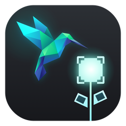
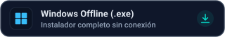

<div align="center">



# ZunzShot

**Capturador de pantalla instantáneo, ultra liviano y creativo para macOS y Windows.**

[](#descargas)
[](#descargas)
[](#funcionalidades-e-íconos)

<br />

<a href="https://github.com/ExtremeRayoX/ZunzShot/releases/download/v1.0.4/ZunzShot_1.0.4_x64-setup.exe"></a>
&nbsp;&nbsp;
<a href="https://github.com/ExtremeRayoX/ZunzShot/releases/download/v1.0.4/ZunzShot_1.0.4_universal.dmg"></a>

<br />

<a href="https://github.com/ExtremeRayoX/ZunzShot/releases/download/v1.0.4/ZunzShot_1.0.4_x64-offline-setup.exe"></a>

</div>

---

## Descargas

Haz clic directamente en la imagen de tu sistema operativo arriba o en tu instalador abajo para iniciar la **descarga directa al instante** *(sin páginas intermedias)*:

| Sistema | Plataforma | Descarga directa | Detalles |
| :---: | :--- | :--- | :--- |
|  | **Windows 10 / 11 (Ligero — recomendado)** | [Descargar instalador (.exe)](https://github.com/ExtremeRayoX/ZunzShot/releases/download/v1.0.4/ZunzShot_1.0.4_x64-setup.exe) | Instalador compacto con selector de idioma (**Español / English**) y actualizaciones automáticas. |
|  | **Windows 10 / 11 (Offline completo)** | [Descargar offline (.exe)](https://github.com/ExtremeRayoX/ZunzShot/releases/download/v1.0.4/ZunzShot_1.0.4_x64-offline-setup.exe) | Paquete autónomo para instalar sin conexión a internet, con todas las funciones incluidas. |
|  | **macOS 12.3+ (Apple Silicon e Intel)** | [Descargar para macOS (.dmg)](https://github.com/ExtremeRayoX/ZunzShot/releases/download/v1.0.4/ZunzShot_1.0.4_universal.dmg) | Arrastra **ZunzShot** a **Aplicaciones** y otorga permiso de **Grabación de Pantalla** la primera vez. |

> **Nota para macOS:** Si al abrir por primera vez aparece un aviso de desarrollador no verificado, haz **clic derecho → Abrir** sobre la app en Aplicaciones o ejecuta en Terminal:
> ```bash
> xattr -cr /Applications/ZunzShot.app
> ```

---

## Funcionalidades e Íconos

Al activar una captura aparece la interfaz flotante con los **modos de captura**, la **barra horizontal de edición**, las **herramientas creativas** y la **barra vertical de acciones**. Aquí tienes qué hace cada ícono tal como aparece en la aplicación:

### Modos de captura

| Ícono | Modo | Atajo macOS | Atajo Windows | Para qué sirve |
| :---: | :--- | :---: | :---: | :--- |
|  | **Copiado rápido** | `⌘ + ⇧ + D` | `Ctrl + Shift + D` | Selecciona cualquier área y, al soltar el cursor, copia la imagen al portapapeles de inmediato, cierra el selector y muestra un aviso flotante sin quitar el foco de tu ventana activa. |
|  | **Capturar encuadre** | `⌘ + ⇧ + X` | `Ctrl + Shift + X` | Dibuja una selección rectangular movible y redimensionable con lupa de precisión de píxeles y barra de edición completa. |
|  | **Captura circular** | `⌘ + ⇧ + C` | `Ctrl + Shift + C` | Recorta en forma circular o elíptica con fondo transparente (exportado en PNG), ideal para avatares y detalles circulares. |
|  | **Capturar ventana** | `⌘ + ⇧ + W` | `Ctrl + Shift + W` | Detecta y resalta automáticamente ventanas y aplicaciones abiertas para capturarlas con un clic. |
|  | **Pantalla completa** | `⌘ + ⇧ + F` | `Ctrl + Shift + F` | Selecciona al instante todo el monitor activo listo para editar, copiar, fijar o guardar. |

---

### Barra horizontal de herramientas y edición

| Ícono | Herramienta | Para qué sirve |
| :---: | :--- | :--- |
|  | **Seleccionar / Mover** | Ajusta libremente el recuadro de captura o arrastra y redimensiona stickers, fotos y pasos agregados encima. |
|  | **Lápiz libre** *(submenú Trazos)* | Dibuja anotaciones a mano alzada sobre cualquier parte de la captura. |
|  | **Resaltador** *(submenú Trazos)* | Destaca texto o áreas importantes con trazo translúcido tipo marcador. |
|  | **Subrayar** *(submenú Trazos)* | Traza líneas rectas horizontales perfectas para subrayar frases o cifras rápidamente. |
|  | **Flecha** | Señala botones, menús o elementos clave con flechas nítidas y personalizables. |
|  | **Rectángulo** *(submenú Formas)* | Enmarca zonas o bloques completos mediante rectángulos limpios. |
|  | **Círculo / Óvalo** *(submenú Formas)* | Rodea íconos, números o elementos concretos con óvalos o círculos. |
|  | **Texto** | Inserta etiquetas y comentarios escritos directamente sobre la imagen con fondo legible. |
|  | **Pixelar / Censurar** | Aplica efecto mosaico para ocultar contraseñas, correos, rostros o datos confidenciales. |
|   | **Recorte Rectangular / Circular** | Convierte tu selección actual entre rectángulo y círculo en cualquier momento sin perder tus trazos. |
|  | **Extras y Stickers** | Abre el menú de elementos creativos para añadir imágenes, hora congelada y pasos numerados. |
|  | **Color y Grosor** | Elige entre los colores de la paleta, ajusta el grosor (`S / M / L`) o activa el cuentagotas. |
|  | **Cuentagotas `#HEX`** *(dentro de Color)* | Amplía los píxeles bajo el cursor y copia el código `#HEX` exacto del color al portapapeles. |
|  | **Deshacer** | Revierte el último trazo, forma o sticker agregado *(también `⌘/Ctrl + Z` y rehacer con `⌘/Ctrl + ⇧ + Z` o `Ctrl + Y`)*. |

#### Dentro de Extras y Stickers

| Ícono | Extra | Para qué sirve |
| :---: | :--- | :--- |
|  | **Foto / Imagen superpuesta** | Inserta una imagen estática sobre tu captura (desde archivo o pegando directo con `⌘/Ctrl + V`) con recorte cuadrado, redondeado o circular. |
|  | **Sticker de Fecha y Hora** | Coloca un sello visual elegante con la fecha y hora exacta en que se tomó la captura (configurable en 12h/24h y estilos). |
|  | **Pasos numerados (`1, 2, 3...`)** | Agrega burbujas numeradas consecutivas para crear guías visuales y tutoriales paso a paso en segundos. |

---

### Barra vertical de acciones *(editable en Ajustes)*

| Ícono | Acción | Atajo macOS | Atajo Windows | Para qué sirve |
| :---: | :--- | :---: | :---: | :--- |
|  | **Copiar** | `⌘ + C` | `Ctrl + C` | Copia la captura final con todas sus anotaciones y stickers al portapapeles. |
|  | **Guardar** | `⌘ + S` | `Ctrl + S` | Exporta la captura a disco en formato **PNG** o **JPG** en la carpeta que prefieras. |
|  | **Fijar en pantalla (Pin)** | `⌘ + ⇧ + P` | `Ctrl + Shift + P` | Convierte el recorte en una ventana flotante siempre visible sobre tus demás apps *(con control de opacidad y copiado rápido)*. |
|  | **Compartir** | `⌘ + ⇧ + E` | `Ctrl + Shift + E` | Abre las opciones de uso compartido del sistema para enviar la captura al instante. |
|  | **Imprimir** | `⌘ + P` | `Ctrl + P` | Envía la captura directamente al diálogo de impresión del sistema. |
|  | **Cancelar / Cerrar** | `Esc` | `Esc` | Cierra la captura limpia y vuelve al estado en segundo plano sin dejar rastros. |

---

## Notas de Versión

### `v1.0.4`
- **Instancia única y bandeja del sistema en Windows:** Prevención de procesos e íconos duplicados al abrir la aplicación cuando ya está en ejecución y corrección de respuesta al clic en la bandeja del sistema.
- **Atajos globales y foco reforzados:** Detección de atajos reservados por el sistema operativo con aviso en ajustes, respaldo seguro al grabar combinaciones y refuerzo de foco del lienzo en Windows.
- **Precisión multi-monitor y DPI mixto:** Posicionamiento y escalado exacto de notificaciones de copiado y capturas fijadas (`Pin`) entre monitores con distintas resoluciones o escalas, sin parpadeos iniciales.
- **Estabilidad en Compartir, Imprimir y Guardado:** Ajuste automático del nivel de ventana para no cubrir diálogos del sistema en Windows y macOS, limpieza automática de archivos temporales y avisos claros ante cualquier error.

### `v1.0.3`
- **Arreglo de atajos y foco en Windows:** Corrección de errores de foco de ventana y activación que impedían usar los atajos globales (`Ctrl+Shift+D/X/C/W/F`) y los comandos internos (`Esc`, `Ctrl+C`, `Ctrl+S`, `Ctrl+Shift+P`, `Ctrl+Shift+E`, `Ctrl+P`, deshacer/rehacer y flechas) en Windows.
- **Eliminación de rastro de trazos previos:** Limpieza sincronizada del lienzo, selecciones y objetos temporales entre capturas para evitar destellos momentáneos de anotaciones anteriores al iniciar una nueva captura.
- **Limpieza automática de memoria:** Liberación inmediata de caché gráfica e imágenes superpuestas tras cerrar o completar una captura, y cambio directo de modo con el selector abierto.
- **Descarga directa desde portada:** Botones visuales independientes para Windows y macOS con descarga directa al instante sin pasar por páginas intermedias.

### `v1.0.2`
- **Permisos simplificados en macOS:** Flujo de permisos iniciales depurado con un único botón directo y detección automática al conceder el permiso.
- **Estabilidad de copiado rápido:** Mejoras en el cierre del selector y reintentos del portapapeles tras copiar una selección directa.
- **Guía visual renovada:** Incorporación de los íconos oficiales de cada herramienta y documentación completa de funciones.

### `v1.0.1`
- **Dos opciones de instalador para Windows:** Incorporación de la edición **Ligera** (descarga rápida) junto a la edición **Offline completa** para instalaciones sin conexión.
- **Actualizaciones automáticas multiplataforma:** Integración del canal de publicación y actualización automática unificado para Windows y macOS.
- **Ajustes visuales y de configuración:** Mejoras menores en los textos de interfaz, sección *Acerca de* y flujo inicial de configuración.

### `v1.0.0`
- **Lanzamiento inicial multiplataforma:** Primera versión pública para macOS y Windows concebida como una herramienta ágil en segundo plano de consumo mínimo.
- **Cinco modos de captura:** Región libre, Copiado rápido sin edición intermedia, Recorte circular transparente, Detección de ventanas y Pantalla completa.
- **Editor completo integrado:** Barra en L adaptable con trazos, flechas, formas, texto, pixelado, cuentagotas con lupa de píxeles, pasos numerados, imágenes superpuestas, sello de fecha/hora y fijado en pantalla.
- **Personalización y bilingüismo:** Soporte completo en **Español** e **Inglés**, atajos configurables, inicio automático opcional y **Modo Ultra Liviano**.

---

<div align="center">

Desarrollado por **ERX**

</div>
