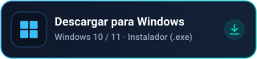
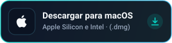

<p align="right">
  <strong>🇪🇸 Español</strong> &nbsp;|&nbsp; <a href="README.en.md">🇺🇸 English</a>
</p>

<div align="center">


# ZunzShot

**Capturador de pantalla instantáneo, ultra liviano y creativo para macOS y Windows.**

[](#descargas-v108)
[](#descargas-v108)
[](README.en.md)

<br />

<a href="https://github.com/ExtremeRayoX/ZunzShot/releases/download/v1.0.8/ZunzShot_1.0.8_x64-setup.exe"></a>
&nbsp;&nbsp;
<a href="https://github.com/ExtremeRayoX/ZunzShot/releases/download/v1.0.8/ZunzShot_1.0.8_universal.dmg"></a>

</div>

---

## Descargas (`v1.0.8`)

Versión actual disponible: **ZunzShot v1.0.8**. Haz clic directamente en la imagen de tu sistema operativo arriba o en tu instalador abajo para iniciar la **descarga directa al instante** *(sin páginas intermedias)*:

| Sistema | Plataforma | Descarga directa (`v1.0.8`) | Detalles |
| :---: | :--- | :--- | :--- |
|  | **Windows 10 / 11 (64-bit)** | [Descargar v1.0.8 (.exe)](https://github.com/ExtremeRayoX/ZunzShot/releases/download/v1.0.8/ZunzShot_1.0.8_x64-setup.exe) | Instalador oficial compacto con selector de idioma (**Español / English**) y actualizaciones automáticas. |
|  | **macOS 12.3+ (Apple Silicon e Intel)** | [Descargar v1.0.8 para macOS (.dmg)](https://github.com/ExtremeRayoX/ZunzShot/releases/download/v1.0.8/ZunzShot_1.0.8_universal.dmg) | Arrastra **ZunzShot** a **Aplicaciones** y otorga permiso de **Grabación de Pantalla** la primera vez. |

> **Nota para macOS:** Si al abrir por primera vez aparece un aviso de desarrollador no verificado, haz **clic derecho → Abrir** sobre la app en Aplicaciones o ejecuta en Terminal:
> ```bash
> xattr -cr /Applications/ZunzShot.app
> ```

---

## Privacidad y Funcionamiento 100 % Local

ZunzShot está diseñado bajo un enfoque **local-first** para proteger tu pantalla y tus datos:

- **Procesamiento 100 % en tu equipo:** Todas las capturas, anotaciones, stickers, textos y recortes se procesan y guardan exclusivamente de forma local (RAM, portapapeles o la carpeta que elijas).
- **Sin nube ni terceros:** Tus imágenes nunca se suben ni se comparten con servidores externos salvo que tú mismo uses la acción de **Compartir** o **Guardar**.
- **Sin telemetría ni rastreo:** No recopila estadísticas de uso, analítica, publicidad ni requiere cuentas o inicio de sesión.
- **Conexión de red opcional únicamente para actualizaciones:** La única conexión externa posible es consultar los lanzamientos oficiales en GitHub (`github.com/ExtremeRayoX/ZunzShot/releases`) si activas la búsqueda automática o pulsas *Buscar actualizaciones* manualmente en Ajustes (puedes desactivarlo en cualquier momento).

---

## Funcionalidades e Íconos

Al activar una captura aparece la interfaz flotante con los **modos de captura**, la **barra horizontal de edición**, las **herramientas creativas** y la **barra vertical de acciones**. Aquí tienes qué hace cada ícono tal como aparece en la aplicación:

### Modos de captura

| Ícono | Modo | Atajo macOS | Atajo Windows | Para qué sirve |
| :---: | :--- | :---: | :---: | :--- |
|  | **Copiado rápido** | `⌘ + ⇧ + D` | `Ctrl + Shift + D` | Selecciona cualquier área y, al soltar el cursor, copia la imagen al portapapeles de inmediato, cierra el selector y muestra un aviso flotante sin quitar el foco de tu ventana activa. |
|  | **Capturar encuadre** | `⌘ + ⇧ + X` | `Ctrl + Shift + X` | Dibuja una selección rectangular movible y redimensionable con lupa de precisión de píxeles y barra de edición completa. |
|  | **Captura circular** | `⌘ + ⇧ + C` | `Ctrl + Shift + C` | Recorta en forma circular o elíptica con fondo transparente (exportado en PNG), ideal para avatares y detalles circulares. |
|  | **Capturar ventana** | `⌘ + ⇧ + W` | `Ctrl + Shift + W` | Detecta y resalta automáticamente ventanas y aplicaciones abiertas para capturarlas con un clic. |
|  | **Pantalla completa** | `⌘ + ⇧ + F` | `Ctrl + Shift + F` | Selecciona al instante todo el monitor activo listo para editar, copiar, fijar o guardar. |

> **Atajos personalizables en Ajustes:** Puedes cambiar cualquier combinación desde **Ajustes → Atajos**. En Windows también puedes asignar la tecla **`Impr Pant` (`PrtSc`)** por sí sola o combinada *(por ejemplo `Shift + PrtSc`)*.

---

### Barra horizontal de herramientas y edición

| Ícono | Herramienta | Para qué sirve |
| :---: | :--- | :--- |
|  | **Seleccionar / Mover** | Ajusta libremente el recuadro de captura o arrastra y ajusta textos, stickers, fotos y pasos agregados encima. |
|  | **Lápiz libre** *(submenú Trazos)* | Dibuja anotaciones a mano alzada sobre cualquier parte de la captura. |
|  | **Resaltador** *(submenú Trazos)* | Destaca texto o áreas importantes con trazo translúcido tipo marcador. |
|  | **Subrayar** *(submenú Trazos)* | Traza líneas rectas horizontales perfectas para subrayar frases o cifras rápidamente. |
|  | **Flecha** | Señala botones, menús o elementos clave con flechas nítidas y personalizables. |
|  | **Rectángulo** *(submenú Formas)* | Enmarca zonas o bloques completos mediante rectángulos limpios. |
|  | **Círculo / Óvalo** *(submenú Formas)* | Rodea íconos, números o elementos concretos con óvalos o círculos. |
|  | **Texto** | Inserta etiquetas **editables** sobre la imagen: cambia en vivo o al seleccionarlas el **fondo** (*Con fondo* / *Sin fondo*), **negrita (`B`)**, **cursiva (`I`)**, tamaño (`A-` / `A+` de `12px` a `72px`) y color; arrástralas, muévelas con las flechas o haz **doble clic** para volver a editarlas. |
|  | **Pixelar / Censurar** | Aplica efecto mosaico para ocultar contraseñas, correos, rostros o datos confidenciales. |
|   | **Recorte Rectangular / Circular** | Convierte tu selección actual entre rectángulo y círculo en cualquier momento sin perder tus trazos. |
|  | **Extras y Stickers** | Abre el menú de elementos creativos para añadir imágenes, hora congelada y pasos numerados. |
|  | **Color y Grosor** | Elige entre los colores de la paleta, ajusta el grosor (`S / M / L`) o activa el cuentagotas. |
|  | **Cuentagotas `#HEX`** *(dentro de Color)* | Amplía los píxeles bajo el cursor y copia el código `#HEX` exacto del color al portapapeles. |
|  | **Deshacer** | Revierte el último trazo, forma o sticker agregado *(también `⌘/Ctrl + Z` y rehacer con `⌘/Ctrl + ⇧ + Z` o `Ctrl + Y`)*. |

#### Dentro de Extras y Stickers

| Ícono | Extra | Para qué sirve |
| :---: | :--- | :--- |
|  | **Foto / Imagen superpuesta** | Inserta una imagen estática sobre tu captura (desde archivo o pegando directo con `⌘/Ctrl + V`) con recorte cuadrado, redondeado o circular. |
|  | **Sticker de Fecha y Hora** | Coloca un sello visual elegante con la fecha y hora exacta en que se tomó la captura (configurable en 12h/24h y estilos). |
|  | **Pasos numerados (`1, 2, 3...`)** | Agrega burbujas numeradas consecutivas para crear guías visuales y tutoriales paso a paso en segundos. |

> **Preferencias por defecto en Ajustes → Extras:** Desde la pestaña **Extras** en Ajustes puedes configurar los valores iniciales tanto del **Sticker de Hora y Fecha** *(formato 12h/24h, segundos, fecha y estilo)* como de **Texto y Etiquetas** *(fondo por defecto, negrita, cursiva y tamaño inicial `16px`–`36px`)*.

---

### Barra vertical de acciones *(editable en Ajustes)*

| Ícono | Acción | Atajo macOS | Atajo Windows | Para qué sirve |
| :---: | :--- | :---: | :---: | :--- |
|  | **Copiar** | `⌘ + C` | `Ctrl + C` | Copia la captura final con todas sus anotaciones y stickers al portapapeles. |
|  | **Guardar** | `⌘ + S` | `Ctrl + S` | Exporta la captura a disco en formato **PNG** o **JPG** en la carpeta que prefieras. |
|  | **Fijar en pantalla (Pin)** | `⌘ + ⇧ + P` | `Ctrl + Shift + P` | Convierte el recorte en una ventana flotante siempre visible sobre tus demás apps *(con control de opacidad y copiado rápido)*. |
|  | **Compartir** | `⌘ + ⇧ + E` | `Ctrl + Shift + E` | Abre las opciones de uso compartido del sistema para enviar la captura al instante. |
|  | **Imprimir** | `⌘ + P` | `Ctrl + P` | Envía la captura directamente al diálogo de impresión del sistema. |
|  | **Cancelar / Cerrar** | `Esc` | `Esc` | Cierra la captura limpia y vuelve al estado en segundo plano sin dejar rastros. |

---

## Notas de Versión

### `v1.0.8`
- **Captura continua en múltiples pantallas (macOS y Windows):** Al iniciar una captura se atenúan todas tus pantallas conectadas al mismo tiempo, permitiéndote seleccionar dentro de cualquiera de ellas o arrastrar una captura entre varios monitores sin importar su resolución o ubicación.
- **Controles y avisos en la pantalla activa (macOS y Windows):** Las barras de captura, edición y notificaciones se ajustan automáticamente al monitor donde trabajas sin cortarse entre bordes.
- **Tecla `PrtSc` individual o combinada (Windows):** En **Ajustes → Atajos** ahora puedes asignar `Impr Pant` (`PrtSc`) como atajo global de captura por sí sola o combinada con modificadores *(por ejemplo `Shift + PrtSc`)*.
- **Ícono oficial en el instalador de Windows:** El instalador y desinstalador de Windows ahora muestran el logotipo de ZunzShot.

### `v1.0.7`
- **Mayor fluidez y estabilidad en Windows:** Se corrigieron congelamientos al realizar capturas, usar atajos o abrir Ajustes y notas fijadas (`Pin`).
- **Detección de ventanas más rápida:** El modo *Ventana* responde al instante sin trabarse cuando hay aplicaciones ocupadas.
- **Diálogos siempre visibles y cierre inmediato:** Las ventanas de *Guardar*, *Imprimir* y *Compartir* se muestran siempre por delante, y puedes cerrar la aplicación al instante desde la barra de tareas o la bandeja.

### `v1.0.6`
- **Texto editable y personalizable:** Los textos sobre la captura ahora pueden moverse, ajustarse con las flechas, editarse con **doble clic** y personalizarse al instante con **fondo**, **negrita (`B`)**, **cursiva (`I`)**, tamaño y color.
- **Estilos predeterminados de texto:** Nueva sección **Texto y Etiquetas** en **Ajustes → Extras** con vista previa para definir el formato inicial de tus textos.
- **Instalador único para Windows:** Descargas simplificadas a un único instalador oficial para Windows.

### `v1.0.5`
- **Aviso de nuevas versiones:** ZunzShot detecta actualizaciones disponibles en segundo plano y te permite **Actualizar ahora** o **Recordar más tarde**.
- **Nueva sección Extras en Ajustes:** Reorganización de las herramientas creativas en un menú dedicado que incluye la configuración del **Sticker de Hora y Fecha**.
- **Guardado por sección en Ajustes:** Los botones de **Guardar** y **Descartar** aparecen únicamente cuando realizas cambios en una sección.

### `v1.0.4`
- **Ventana única y bandeja mejorada en Windows:** Evita abrir múltiples copias de la app por error y mejora la respuesta del ícono en la bandeja del sistema.
- **Atajos globales más confiables:** Aviso automático si el sistema reserva una combinación de teclas y mejor respuesta al iniciar capturas en Windows.
- **Ajuste exacto en configuraciones con varios monitores:** Avisos de copiado y capturas fijadas (`Pin`) con posición y tamaño precisos en pantallas de distinta resolución.
- **Compartir, Imprimir y Guardar más estables:** Ventanas del sistema siempre accesibles y avisos claros ante cualquier error.

### `v1.0.3`
- **Atajos corregidos en Windows:** Ya responden correctamente tanto los atajos globales de captura como los comandos dentro del editor.
- **Lienzo limpio entre capturas:** Eliminados los rastros visuales de anotaciones anteriores al iniciar una nueva captura y posibilidad de cambiar de modo sin cerrarla.
- **Descarga directa desde la portada:** Nuevos botones para descargar Windows y macOS en un clic.

### `v1.0.2`
- **Permisos simplificados en macOS:** Acceso inicial simplificado con un solo botón y detección automática al conceder el permiso.
- **Copiado rápido más confiable:** Mejoras al cerrar el selector y copiar selecciones directas al portapapeles.
- **Guía visual renovada:** Nuevos íconos para cada herramienta y documentación completa de funciones.

### `v1.0.1`
- **Nuevas opciones de instalación en Windows:** Incorporación del instalador ligero junto a la edición completa para usar sin conexión.
- **Actualizaciones automáticas:** Sistema integrado de avisos y actualización directa para Windows y macOS.
- **Ajustes visuales y de texto:** Pequeñas mejoras en textos, sección *Acerca de* y bienvenida inicial.

### `v1.0.0`
- **Lanzamiento inicial para macOS y Windows:** Herramienta ligera de captura de pantalla pensada para responder al instante en segundo plano.
- **Cinco modos de captura:** Región libre, Copiado rápido, Recorte circular transparente, Detección de ventanas y Pantalla completa.
- **Editor creativo integrado:** Trazos, flechas, formas, texto, pixelado, selector de color con lupa, pasos numerados, imágenes superpuestas, sello de fecha/hora y notas fijadas en pantalla.
- **Personalizable y bilingüe:** Disponible en **Español** e **Inglés**, con atajos configurables, inicio automático y **Modo Ultra Liviano**.

---

<div align="center">

Desarrollado por **ERX**

</div>
